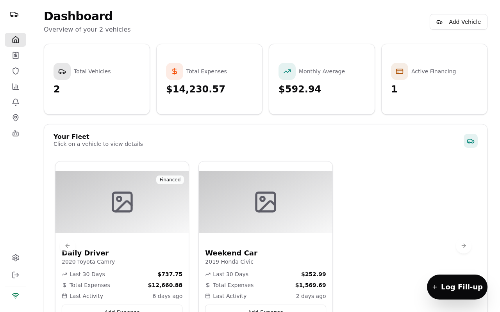
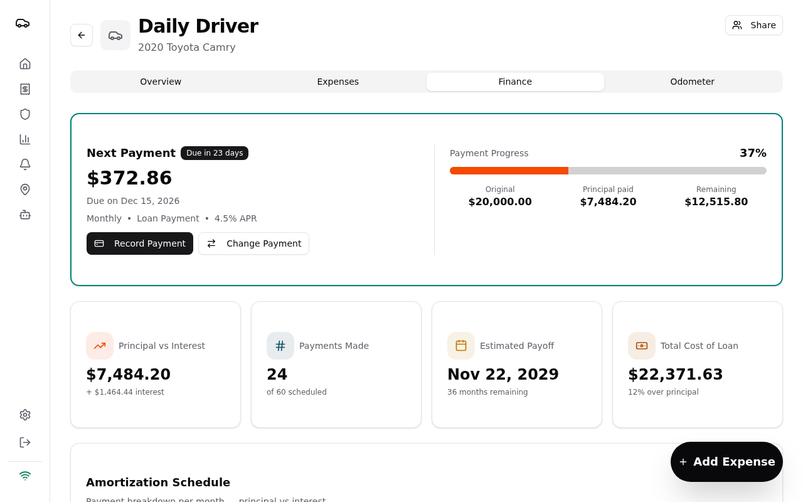
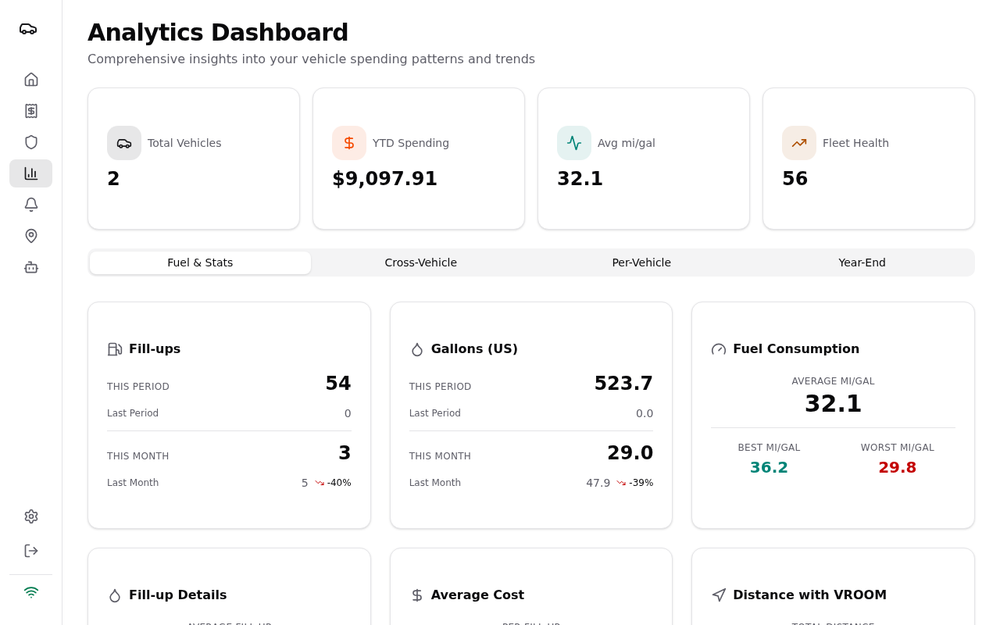
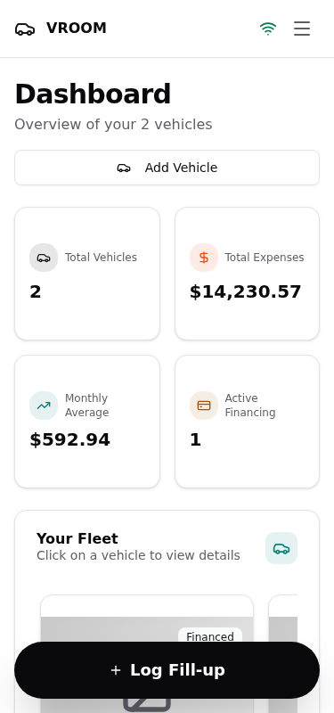
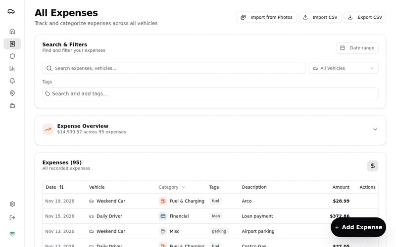

# VROOM

[](https://github.com/OnlyOneByte/VROOM/actions/workflows/ci-cd.yml)


[](https://ko-fi.com/onemorebyte)

VROOM (Vehicle Record & Organization Of Maintenance) is a self-hostable app for tracking what your cars really cost: fuel, maintenance, insurance, financing and trips, with mobile-first design, analytics and backups to your own Google Drive or S3-compatible storage.



| Vehicle loan | Fuel analytics | On a phone |
|---|---|---|
|  |  |  |

<details>
<summary>Adding an expense (GIF)</summary>



</details>

Screenshots show the demo data from `bun run db:seed`.

> ⚠️ **Under active development.** Features, APIs, and database schemas may change between releases. Back up your data regularly to Google Drive or S3-compatible storage. Pin to a specific image tag rather than `latest` for stability.

> 🤖 **AI-native development.** Much of the code is written with AI assistance. Architecture decisions and feature direction come from a human developer, and every change is reviewed by someone other than its author, a human or an independent review agent, before it merges.

## Why VROOM?

- **Open Source** — fork, customize, and host it yourself with full control over your data
- **Open Format** — backups are ZIP files of plain CSV, so there's zero lock-in
- **Your Own Storage** — backups go straight to your Google Drive (with an optional Google Sheets copy) or to any S3-compatible bucket, including a self-hosted MinIO
- **Privacy First** — your data lives on your server and in the storage you connect. AI features are opt-in and use your own API key

## Features

- 📱 Mobile-first PWA that installs on your phone and works offline
- 🚗 Multi-vehicle tracking for gas, electric and hybrid cars, with odometer history
- ⛽ Fuel and charging logs with efficiency tracking
- 🧮 Expenses that can be split across several vehicles
- 📊 Interactive analytics: cost breakdowns, trends and cross-vehicle comparisons
- 💰 Financing (loans and leases), and insurance policies and claims, with premiums split across vehicles
- 🗺️ Trip logging
- ⏰ Reminders by date, mileage or both, for maintenance and recurring expenses, with optional web push notifications
- 👥 Vehicle sharing with other VROOM users
- 📥 CSV import from Fuelio, Fuelly and Drivvo, or any CSV with manual column mapping, and CSV export of expenses
- 📷 Photos for receipts, vehicles, odometer readings and insurance, stored in Google Drive, Google Photos or S3-compatible storage
- 📅 A private calendar link with your reminders, insurance renewals and loan payments, for Google, Apple or Outlook Calendar
- 🧾 Receipt scanning that fills in the expense form, with a built-in text reader on your server or an AI vision model you configure
- 💬 An assistant that answers questions about your vehicles and costs, using Anthropic, Gemini or any OpenAI-compatible model
- 💾 ZIP backups to Google Drive or S3-compatible storage, Google Sheets sync, and restore from a backup file
- 🔐 Sign-in with Google or GitHub (OAuth)
- 🐳 Docker images for self-hosting

## Tech Stack

| Layer | Technologies |
|---|---|
| Frontend | SvelteKit, Svelte 5 (runes), Tailwind CSS v4, shadcn-svelte, layerchart, Zod, Vitest + Playwright |
| Backend | Hono on Bun, Drizzle ORM + SQLite (or opt-in Postgres, see [docs/deployment.md](docs/deployment.md#postgres-opt-in)), Lucia Auth, Biome |
| Infra | Docker, GitHub Actions CI/CD, GitHub Container Registry |

## Quick Start

### Before you start: OAuth

There is no demo account. Sign-in is OAuth only, so you need your own OAuth app before
anyone can sign in: Google (required for production) or GitHub (enough for local
development). The [Development Guide](docs/development.md#signing-in) has the callback URLs,
and the [Deployment Guide](docs/deployment.md#google-oauth-setup) covers production.

### Local Development

You need [Bun](https://bun.sh/) for the backend and the Node.js version in `.nvmrc` for the
frontend. Run the backend (`bun run dev`, port 3001) and the frontend (`npm run dev`, port
5173) side by side; the [Development Guide](docs/development.md) has the full setup.

### Docker

You need Docker 20.10+ with Compose v2.

```bash
cp docs/examples/.env.example .env             # fill in the Google OAuth values and PROVIDER_ENCRYPTION_KEY
cp docs/examples/docker-compose.yml .
mkdir -p data                                  # the DATA_PATH bind mount; Docker won't create it
docker compose up -d
# Frontend: http://localhost:3000
# Backend:  http://localhost:3001
```

Without a Cloudflare tunnel, delete the `cloudflared` service from `docker-compose.yml`
first: with an empty token it restarts forever. See the [Deployment Guide](docs/deployment.md)
for full instructions.

## Project Structure

```
vroom/
├── backend/        # Bun + Hono API. One folder per domain under src/api/: routes.ts
│                   # plus any *repository.ts it needs. Migrations in drizzle/.
├── frontend/       # SvelteKit PWA. Components, services, stores, and utils
│                   # under src/lib/; file-based routing under src/routes/.
├── docs/           # Architecture, development, and deployment guides
│   └── examples/   # Docker Compose, Portainer stack, .env template
└── .github/        # CI/CD pipeline
```

## Documentation

| Document | Description |
|---|---|
| [Architecture](docs/architecture.md) | System design, data flow, and the reasoning behind it |
| [Development Guide](docs/development.md) | Local setup, workflow, and testing |
| [Deployment Guide](docs/deployment.md) | Docker, self-hosting, reverse proxy, and SSL |
| [Conventions](docs/conventions/) | Coding rules for each area: code quality, Svelte, API, permissions, migrations, testing, design system, UI |
| [Contributing](CONTRIBUTING.md) | How to propose and submit a change |

## Contributing

Contributions are welcome. [CONTRIBUTING.md](CONTRIBUTING.md) covers the workflow: one issue
per pull request, `Fixes #N` in the PR, the coding rules in [`docs/conventions/`](docs/conventions/),
and the validation to run before you push. To report a security problem, see
[SECURITY.md](SECURITY.md).

## Support

If VROOM is useful to you, consider buying me a coffee:

[](https://ko-fi.com/onemorebyte)

## License

VROOM (Vehicle Record & Organization Of Maintenance), Copyright (C) 2025 Rengang (Angelo) Yang.

VROOM is free software: you can redistribute it and/or modify it under the terms of the GNU
Affero General Public License as published by the Free Software Foundation, either version 3
of the License, or (at your option) any later version (`AGPL-3.0-or-later`). The full text is
in [LICENSE](LICENSE).
